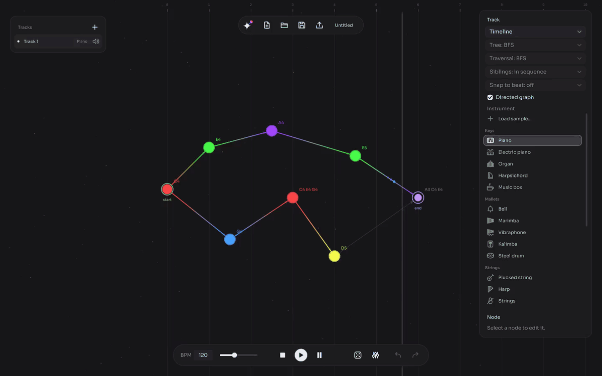

<p align="center">
  <picture>
    <source media="(prefers-color-scheme: light)" srcset="docs/images/banner-light.svg">
    
  </picture>
</p>

<p align="center">
  <strong>Make music by drawing graphs.</strong><br>
  Nodes are notes and chords, edges are the paths between them, and the music comes out of walking the graph.
</p>

<p align="center">
  <a href="https://github.com/bfailach/Chimedes/releases/latest"></a>
  <a href="https://github.com/bfailach/Chimedes/actions/workflows/ci.yml"></a>
  <a href="LICENSE"></a>
  
  
  
</p>

<p align="center">
  <a href="https://github.com/bfailach/Chimedes/releases/latest"><strong>Download for Windows</strong></a> ·
  <a href="#features">Features</a> ·
  <a href="#quick-start">Quick start</a> ·
  <a href="docs/user-guide.md">User guide</a> ·
  <a href="#building-from-source">Build from source</a>
</p>

<p align="center">
  
</p>

## About

Chimedes is a desktop app for making generative music without a piano roll or a grid. You place notes as stars on a canvas, connect them, and Chimedes plays the graph in a loop: either along a timeline, where a node's position is its beat, or by turning the graph into a tree and walking it with search algorithms such as BFS, DFS, Dijkstra or Prim. Change the algorithm and the same graph becomes a different piece.

Everything can be randomized, from the shape of the graph to the notes, the rhythm, the instruments and the algorithm, so it doubles as an instrument for happy accidents.

## Features

- 🌌 **Graph editor**: double-click to add a note, drag to connect, right-click to set the start and end. Full undo and redo.
- 🔀 **Two ways to play**: *timeline* mode, or *algorithm* mode with BFS, DFS, Dijkstra and Prim trees walked by BFS or DFS, with siblings in sequence or together.
- 🎹 **Notes and chords** from an on-screen keyboard or straight from your computer keyboard.
- 🔔 **22 synthesized instruments** (piano, electric piano, organ, bells, marimba, harp, strings, choir, pads, basses and more), plus **your own samples** (WAV, AIFF, FLAC, OGG).
- 🎚️ **Up to 16 tracks** playing at once, each with its own cycle length, for natural polyrhythms.
- 🎲 **Randomize** the graph, notes, rhythm, instruments or algorithm, one track or all of them, in one undoable step.
- 💾 **Projects** as readable `.chimedes` JSON files.
- 📤 **Export** to WAV (48 kHz, 24-bit) or MIDI, to keep working in your DAW.
- ✨ **Starlight theme**: a star atlas where each note flashes in its own colour as it plays.

## Download

Get the latest **`Chimedes-x.y.z-windows-x64.exe`** from the [Releases page](https://github.com/bfailach/Chimedes/releases/latest) and run it. There is nothing to install.

> [!NOTE]
> The executable is not code-signed yet, so Windows SmartScreen may warn you the first time. Choose **More info → Run anyway**. You can check the download against `SHA256SUMS.txt` in the release.

macOS and Linux builds are not published yet; you can [build from source](#building-from-source) on either.

## Quick start

1. Open Chimedes. It starts with *Carousel*, a short waltz for kalimba drawn as a ring of stars; press **Space** to play it.
2. **Double-click** on empty space to add a node, and **drag from the edge of a node** to another to connect them.
3. Pick a note on the keyboard in the right panel (or press **A W S E D F…** on your keyboard) and press **Enter** to give it to the node.
4. Switch the track to **Algorithm** mode and try different trees and traversals.
5. Press **R** (the dice) to randomize, and the sliders button next to it to choose what gets randomized.
6. Export to WAV or MIDI from the tray icon in the top bar.

The [user guide](docs/user-guide.md) covers every action, instrument and option.

<details>
<summary><strong>Keyboard shortcuts</strong></summary>

| Shortcut | Action |
| --- | --- |
| Space | Play / pause |
| Double-click | New node |
| Delete, Backspace | Delete selection |
| A W S E D F T G Y H U J K O L P | Play notes (several at once for a chord) |
| Z / X | Octave down / up |
| Enter / Esc | Save / discard the proposed note |
| R | Randomize |
| Ctrl+Z, Ctrl+Y | Undo, redo |
| Ctrl+N, Ctrl+O, Ctrl+S | New, open, save |
| Ctrl+Shift+S | Save as |

</details>

## How it works

The engine turns each track into a **schedule**, the list of notes in one cycle with their starting beat, and the audio engine only plays that schedule:

- **Timeline mode**: each node sounds at the beat given by its horizontal position. The cycle runs from the start node until the end node finishes.
- **Algorithm mode**: the graph becomes a tree rooted at the start node (BFS, DFS, Dijkstra or Prim) and is walked with BFS or DFS. The wait between two notes is the length of the edge that joins them.

Each track loops on its own cycle, so a 3-beat track against a 4-beat one makes a pattern that repeats every 12 beats.

## Building from source

Chimedes is written in C++20 with [JUCE](https://juce.com) 9 and builds with CMake 3.22 or later. Clone with submodules, because JUCE lives in `JUCE/`:

```sh
git clone --recurse-submodules https://github.com/bfailach/Chimedes.git
cd Chimedes
cmake -S . -B build -DCMAKE_BUILD_TYPE=Release
cmake --build build --config Release
```

If you already cloned without submodules, run `git submodule update --init`.

- **Windows**: Visual Studio 2022 or later. The app is in `build/Chimedes_artefacts/Release/Chimedes.exe`.
- **macOS**: Xcode.
- **Linux** (Ubuntu/Debian) needs these headers:

  ```sh
  sudo apt install libasound2-dev libx11-dev libxrandr-dev libxinerama-dev \
    libxcursor-dev libxext-dev libxi-dev libxrender-dev libxcomposite-dev \
    libfreetype-dev libfontconfig1-dev libgl1-mesa-dev
  ```

### Tests

The model and the engine do not depend on JUCE, so their tests build in seconds:

```sh
cmake -S . -B build-tests -DCHIMEDES_BUILD_APP=OFF
cmake --build build-tests
ctest --test-dir build-tests --output-on-failure
```

## Project structure

```text
Source/
├── model/    Project, tracks, nodes and edges (plain C++)
├── engine/   Validation, trees, traversals, schedules, sequencer and export (plain C++)
├── audio/    Audio engine, synthesizers and offline rendering (JUCE)
├── ui/       JUCE user interface
└── Main.cpp  Application entry point
Tools/        Development tools (ChimedesRender, offline rendering to WAV)
Tests/        Engine tests
docs/         User guide and images
JUCE/         Git submodule (JUCE 9.0.4)
```

## Roadmap

- [x] Graph editor, timeline and algorithm modes
- [x] Projects, multiple tracks, live editing and custom samples
- [x] Randomize everything, export to WAV and MIDI
- [x] Windows release
- [ ] macOS and Linux releases
- [ ] Code-signed Windows executable

See the [changelog](CHANGELOG.md) for what changed in each version.

## Contributing

Bug reports, ideas and pull requests are welcome. Please read [CONTRIBUTING.md](CONTRIBUTING.md) first, and use the [issue templates](https://github.com/bfailach/Chimedes/issues/new/choose).

## Licence

Chimedes is free software, released under the [GNU Affero General Public License v3.0](LICENSE). It is built with [JUCE](https://juce.com), used under the AGPLv3.

The bundled fonts, [Sora](https://github.com/sora-xor/sora-font) and [DM Mono](https://github.com/googlefonts/dm-mono), are under the [SIL Open Font License](Resources/Fonts).
